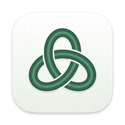
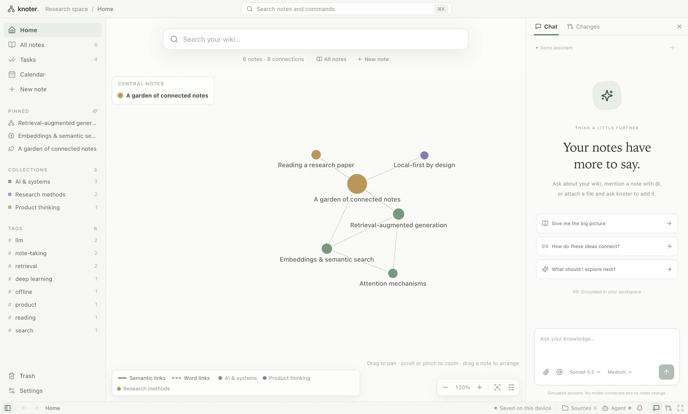
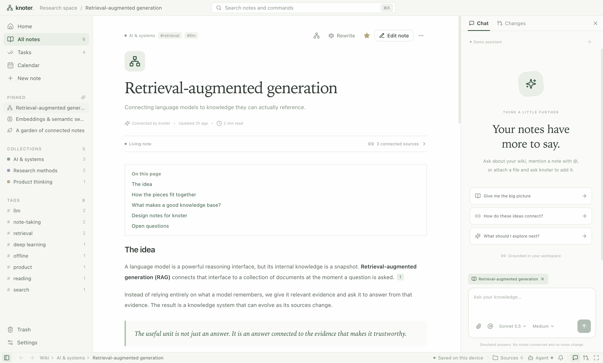
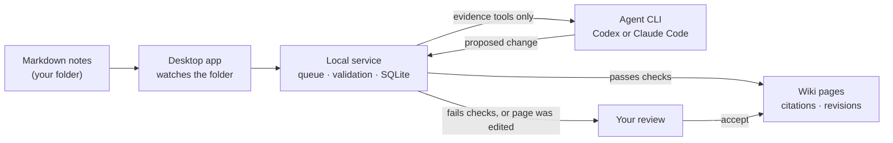

<div align="center">



# knoter

**Your notes, tied into a wiki that cites its sources.**

A local-first desktop app that turns a folder of Markdown notes into a linked,
source-backed wiki and keeps it current as the notes change.


[Overview](#overview) · [How it works](#how-it-works) · [Quick start](#quick-start) ·
[Built with](#built-with) · [Scope](#scope-and-limits) · [Documentation](#documentation)



<sub>Browser preview with demo data. Answers there are simulated.</sub>

</div>

## Overview

You write notes; knoter sorts them into topic pages. An AI agent (Codex CLI or
Claude Code) proposes each change, and a local service applies it only after
checking its form and its evidence; a change that fails those checks, or that
touches a page you edited, waits for your review. What the model adds beyond your
notes is marked as a supplement, at a share you set. Pages cite the note passages
they came from, and you find them through search, backlinks, tags, and a graph of
the whole wiki. Notes, pages, and their history stay in a local SQLite workspace;
the original files are never modified.

| | |
| --- | --- |
| **Source-backed pages** | Every page cites the note passages it was written from, and each change is a revision you can restore. |
| **Checked before applied** | The service validates what the agent proposes. The model gets no shell, file, or database access. |
| **Your edits come first** | A change to a page you edited becomes a suggestion for you to accept or reject. |
| **Marked supplements** | Knowledge from the model or the web stays visibly apart from your own material. |
| **One connected wiki** | Search, backlinks, tags, and a graph of every note and the links between them. |
| **Side chat** | Ask about your wiki, mention a note with `@`, or ask for a change that goes through the same checks. |
| **Local-first** | The workspace is a SQLite database on your Mac. Source files are read, never rewritten. |

<div align="center">



<sub>A wiki page with its connected sources and citations (browser preview, demo data).</sub>

</div>

## How it works



1. The app notices a new or changed note and registers that exact version with the
   service.
2. A background service, which keeps running after the window closes, queues the
   work and starts an agent run.
3. The agent reads your notes and the related pages through read-only tools and
   proposes a change.
4. The service checks the proposal's form and evidence, then applies it as a new
   revision or holds it for your review.

## Quick start

### Browser preview

No agent or account needed; it runs on demo data kept in the browser. Use Node.js
22.14 or newer.

```sh
cd v2
npm install
npm run dev
```

### Native app

Requires macOS 26 or newer on Apple Silicon, Xcode 26 or newer, Node **22.14.0**,
and a logged-in Codex CLI or Claude Code.

```sh
cd v2
npm ci
npm run package:demo
```

The app is packaged at `v2/out/knoter-darwin-arm64/knoter.app`. Read the
[app README](v2/README.md) before installing it: it covers CLI versions, enabling
the background service, backups, and replacing an installed build safely.

## Built with

| Layer | Technology |
| --- | --- |
| Desktop shell | Electron, with Swift helpers that register the macOS background service |
| Interface | React, TypeScript, Vite, Tailwind CSS, Radix primitives |
| Graph | WebGL 2 canvas, with a 2D fallback |
| Service | Node.js, SQLite, validated messages between app, service, and agent |
| Agents | Codex CLI or Claude Code, limited to the wiki evidence tools and web search |

## Scope and limits

Packaging currently targets macOS on Apple Silicon, and the build is ad-hoc signed
rather than notarized. Tasks, calendar views, PDF sources, and embedding search are
not part of the native build; the Tasks and Calendar screens in the browser preview
are prototypes. Automated tests and CI are deferred, so changes are verified with
static checks, builds, and manual runs on disposable data. Known failures and
verification limits are recorded in the
[wiki-worker record](docs/lessons/wiki-worker-demo.md).

The app lives in `v2/`, named for the rewrite that replaced the legacy V1
application (CLI, Electron workbench, and vault templates). V1 was removed from
this repository on 2026-11-20 and remains in Git history. The rewrite has its own
storage and runtime contracts and does not read or migrate V1 vaults; existing
vaults keep their customized workflow templates.

## Documentation

| Start here | Purpose |
| --- | --- |
| [App](v2/README.md) | Build, install, and use the native app; its browser preview; limits and failure evidence |
| [Project memory](docs/README.md) | Design reasons, failures, constraints, and future implementation gates |
| [Agent guide](agents.md) | Work rules for changes; start here before editing |

Each package README owns its setup and check commands.
